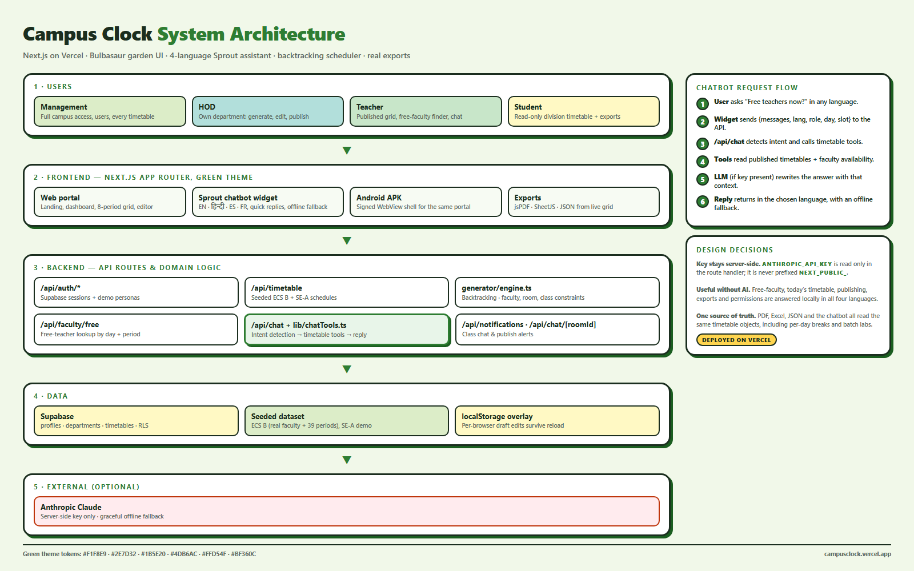

# Campus Clock — Complete Guide

**Academic timetable management for colleges, with a zero-clash generator, an
editable institution directory, and role-based access for Deans, HODs, teachers
and students.**

| | |
|---|---|
| **Live application** | <https://campusclock.vercel.app> |
| **Repository** | <https://github.com/shivamprajapati17/Campus-Clock> |
| **Stack** | Next.js 16 (App Router) · React 19 · TypeScript · Tailwind CSS v4 · Zustand · Supabase · jsPDF/SheetJS |
| **Guide version** | Round 2 — Bulbasaur theme, four-language assistant, ECS B seed data |

---

## Table of contents

1. [What problem it solves](#1-what-problem-it-solves)
2. [A five-minute tour](#2-a-five-minute-tour)
3. [Signing in](#3-signing-in)
4. [Roles and permissions](#4-roles-and-permissions)
5. [Feature reference, screen by screen](#5-feature-reference-screen-by-screen)
6. [Managing institutional data](#6-managing-institutional-data)
7. [How the timetable generator works](#7-how-the-timetable-generator-works)
8. [How authentication works](#8-how-authentication-works)
9. [Architecture and file map](#9-architecture-and-file-map)
10. [API reference](#10-api-reference)
11. [Running it locally](#11-running-it-locally)
12. [What is real and what is simulated](#12-what-is-real-and-what-is-simulated)
13. [Round 2 — theme, Sprout assistant, architecture](#13-round-2--theme-sprout-assistant-architecture)
14. [Verification status](#14-verification-status)

---

## 1. What problem it solves

Building a college timetable by hand fails in predictable ways:

- a professor is assigned to two classes in the same hour;
- two batches are booked into the same room;
- one division is scheduled for two lectures at once;
- laboratory sessions need **two consecutive slots** in a lab, which breaks an
  otherwise workable grid;
- a teacher is pushed past their daily lecture limit.

Campus Clock treats the timetable as a **constraint-satisfaction problem**. A
depth-limited backtracking search places every subject only where no class,
teacher or room is already busy, then a separate validator re-checks the result
and reports any remaining conflict.

The application around that engine is what makes it usable day to day: an
editable list of departments and divisions, a drag-and-drop editor, a substitute
finder, exports for the notice board, and permissions that keep each role to
what it should be doing.

---

## 2. A five-minute tour

1. Open <https://campusclock.vercel.app> and press **Enter Campus Clock** on the
   landing page.
2. On the login screen pick a role — **Dean**, **HOD**, **Teacher** or
   **Student**. The sample address and password fill in automatically.
3. Press **Sign In / Create Account**. You land on `/dashboard`.
4. As the Dean, open **Master Data** in the sidebar. This is the institution
   directory: eight engineering branches, twenty-two class divisions.
5. Press **Add Department**, invent a branch, then **Add Division** inside it.
   The new class is immediately available everywhere else in the portal.
6. Open **Auto Generator**, choose a branch and one of its divisions, and press
   **Generate 0-Clash Timetable**.
7. Open **Live Editor** to drag periods around; clashes appear in a red banner
   the moment they are created.
8. Open **Exports & PDF** to download the grid as PDF, Excel or JSON.

---

## 3. Signing in

The portal at `/login` is a real sign-in, not a mock-up.

**Role profiles.** Four buttons — Dean, HOD, Teacher, Student — prefill a
sample address and password. Those addresses are real accounts with the
permissions of that role:

| Role | Email | Password | Persona |
|---|---|---|---|
| Management (Dean) | `management@campus.edu` | `admin123` | Dr. Arthur Vance — full campus access |
| HOD | `hod.cmpn@campus.edu` | `hod123` | Prof. Rajesh Kulkarni — Computer Engineering |
| Teacher | `teacher.a1@campus.edu` | `teach123` | Prof. Anita Sharma — SE-A class teacher |
| Student | `student.a1@campus.edu` | `stud123` | Aarav Patel — read-only class view |

**Using your own email.** The email and password fields stay editable. Type
your own address, pick the role you want, and sign in: if no account exists for
that address, one is created on the spot in the role you selected, carrying that
role's name, department, division and faculty initials. You are taken straight
to the dashboard as that role — no email confirmation step.

**Wrong password.** If the address already has an account, the portal says so
rather than failing silently: *"That email already has an account — please check
your password."*

**Signing out.** The **Sign Out** button in the sidebar (and on the profile
page) clears both the local persona and the Supabase session, then returns you
to `/login`. `/dashboard` is no longer reachable without signing in again.

---

## 4. Roles and permissions

Four roles, each with a different slice of the portal. Navigation adapts — you
only see the sections your role can use.

| Section | Dean (Management) | HOD | Teacher | Student |
|---|:---:|:---:|:---:|:---:|
| Dashboard overview | ✅ | ✅ | ✅ | ✅ |
| Timetable directory & grid | ✅ | ✅ | ✅ | ✅ published only |
| Auto Generator | ✅ all branches | ✅ own branch | — | — |
| Live drag-and-drop Editor | ✅ | ✅ | — | — |
| **Master Data** (departments & divisions) | ✅ all branches | ✅ own branch only | — | — |
| **Manage Users** | ✅ whole campus | ✅ own department only | — | — |
| Free Faculty Finder | ✅ | ✅ | ✅ | — |
| Campus Chat | ✅ | ✅ | ✅ | ✅ |
| Exports & PDF | ✅ | ✅ | ✅ | ✅ |
| My Profile | ✅ | ✅ | ✅ | ✅ |

Permissions are enforced in two places: `ProtectedRoute` blocks a page outright
if your role is not allowed, and the sidebar hides what you cannot use. An HOD
who opens Master Data or Manage Users sees only their own branch — the queries
are scoped, not merely hidden.

---

## 5. Feature reference, screen by screen

### Landing page — `/`

Marketing overview with the Round 2 tagline ("Grow your perfect schedule 🌱"),
an SVG vine border, leaf motifs, an inline Bulbasaur mascot, a live slice of the
**ECS B** timetable, quick links to the demo accounts, and the entry point into
the Overthinking Engine. The floating 🌱 **Sprout assistant** is available on
every route, including this one.

### Dashboard — `/dashboard`

Your home screen. It shows live counts — departments, divisions, published
timetables and clash rate — taken from the same store the Master Data page
edits, so the numbers move when you add a branch. Below that: the list of active
department timetables with **View Grid** and **Edit** actions, the department
faculty roster with daily caps, recent notifications, and role-aware shortcut
cards.

### Timetable directory — `/dashboard/timetable`

Every timetable in the campus, filterable by tab (all / published / drafts) and
by search across division and branch names. Teachers and students see published
schedules only. Each card links to the grid, the editor and the export centre.

### Timetable grid — `/dashboard/timetable/[id]`

The read-only weekly matrix: five days across, eight periods down, with each
day's break shown in its own cell (P4 on Mon/Wed/Fri for ECS B, P6 on Tue/Thu).
Each cell shows the subject code, faculty initials, room and — where a lab splits
the class — its batch, so parallel batch sessions stack inside one period.
Locked periods are marked.

### Live editor — `/dashboard/editor/[id]`

Drag any period to another slot and the two swap. The banner above the grid
re-validates on every move and turns red with the specific conflict if you create
one — double-booked faculty, colliding rooms, or a class scheduled twice at once.
Locked cells refuse to be displaced. **Undo** steps back through your move
history. **Save Changes** writes the grid to local storage, so the edits survive
navigation and a reload; **Publish** (Management and HOD only) flips the status
that students and teachers are allowed to see.

### Auto generator — `/dashboard/generate`

Pick an academic department, one of its divisions and the term, then press
**Generate 0-Clash Timetable**. The run reports how long the search took, how
many entries it placed, and any clash it could not resolve. The result renders in
the same grid component used elsewhere. Departments and divisions in these
dropdowns come from the live master data, so a branch you just created is
selectable immediately.

### Master Data — `/dashboard/master`

The institutional matrix, and the main editing surface. Covered in detail in
[section 6](#6-managing-institutional-data).

### Manage Users — `/dashboard/users`

The campus directory with add, edit and delete.

- **Dean** sees every account and can grant any role, including Management.
- **HOD** sees only their own department's accounts and can only grant Teacher
  or Student.
- The edit dialog changes name, email, role, department, division and faculty
  initials. The division dropdown narrows to the selected department.
- Validation covers required names, email format, duplicate addresses, and
  duplicate branch codes.

### Free Faculty Finder — `/dashboard/faculty`

Choose a weekday and a slot and the page lists every teacher who is free at that
moment, alongside those already engaged — the list you want when someone calls in
sick. Teachers see it too, so they can arrange their own swaps.

### Campus Chat — `/dashboard/chat`

Four channels: campus-wide announcements, the department faculty room, a class
discussion, and the HOD & Management council. Messages are colour-coded by the
sender's role and are kept in local storage, so a refresh no longer wipes the
conversation.

### Exports & PDF — `/dashboard/exports`

Pick a timetable and a format:

- **PDF** — landscape document with the full Mon–Fri matrix and room assignments,
  built with `jspdf` and `jspdf-autotable`.
- **Excel (.xlsx)** — the same matrix as a worksheet, via SheetJS.
- **JSON** — the raw timetable object for integration.

Every format is generated from the timetable you selected, using its actual
entries — the same matrix the page previews. There is also a **Send to Printer**
action using the browser's print pipeline.

### My Profile — `/dashboard/profile`

Account overview (ID, faculty code, resolved department), a one-click persona
switcher for reviewers, workspace preference toggles, a password-change form and
a sign-out button.

### Overthinking Engine — `/overthinking-engine`

A separate self-contained app that ships alongside Campus Clock. It visualises a
thought spiral as an interactive node graph — root worry, logical branch,
what-if branch, catastrophe, delusion — each with a probability and anxiety
weight, plus grounding quotes and breathing cues. Its engine is exposed at
`POST /api/overthink`.

---

## 6. Managing institutional data

This was the portal's biggest gap: the master matrix used to be read-only. It is
now a full editing surface.

### What ships by default

**Eight departments:** Computer Engineering (CMPN), Information Technology (IT),
Electronics & Telecommunication (EXTC), Artificial Intelligence & Data Science
(AIDS), Mechanical (MECH), Civil (CIVIL), Electrical (ELEC), and Instrumentation
& Control (INST). Each has a named head of department, selectable from the HOD
dropdown.

**Twenty-two divisions**, spread across those branches — CMPN runs five
(SE-A, SE-B, TE-A, TE-B, BE-A), IT and EXTC three each, MECH three, and the rest
two each — each with a semester, a class strength and an optional class teacher.

### Editing departments (Dean only)

- **Add Department** — name, branch code, head of department. Codes must be
  unique; entering one that is taken is rejected with *"The code "CMPN" is
  already used by another branch."*
- **Edit Branch** — rename the department, change its code or reassign the HOD.
- **Delete** — removes the branch **and its divisions**. The confirmation tells
  you how many divisions will go with it before you commit.

### Editing divisions (Dean and HOD)

- **Add Division** — name, semester (1–8), class strength (1–500), class teacher.
- **Edit** — change any of those fields.
- **Delete** — with its own confirmation step.

An HOD sees a single tab — their own branch — and no department controls at all.
They can add, edit and delete divisions inside that branch and nothing outside
it.

### Where the edits live

Institutional data is held in a Zustand store at
`src/store/useMasterData.ts`, seeded from `src/lib/data/mockData.ts` and
persisted to the browser under the `campus_clock_master_data_v1` localStorage
key. The store is hydrated once per page load by the dashboard layout, so your
edits reappear after a reload.

Every other screen reads from the same store, which is why a division created on
the Matrix page instantly shows up in the generator's dropdown and in the
dashboard counters. A **Restore Seeded Data** button returns everything to the
shipped defaults.

> **Important:** these edits are per-browser. They are not shared between
> devices or users. See [section 12](#12-what-is-real-and-what-is-simulated).

---

## 7. How the timetable generator works

`src/lib/generator/engine.ts` is a constraint-based scheduler with
depth-limited backtracking. It schedules **one division at a time**.

### Step 1 — turn assignments into tasks

Each subject-to-faculty assignment becomes one or more *tasks*:

- a **lecture** with `weekly_hours: 4` becomes 4 single-slot tasks;
- a **tutorial** behaves like a lecture;
- a **practical** needs 2 consecutive slots, so it becomes
  `ceil(weekly_hours / 2)` two-slot tasks and always requires a lab room.

### Step 2 — hardest first

Tasks are sorted **practicals → tutorials → lectures**. Practicals are the most
constrained (they need two adjacent slots *and* a lab), so placing them first
avoids a situation where the only remaining gaps are single scattered slots.

### Step 3 — backtracking search

For each task the solver walks days 1–5 and slots 1–7, accepting a placement
only if every constraint holds:

| Constraint | Rule |
|---|---|
| Class not double-booked | The division is free in every slot the task occupies |
| Faculty not double-booked | The teacher is free in every slot the task occupies |
| Room not double-booked | The room is free in every slot the task occupies |
| Faculty daily cap | `max_per_day` is not exceeded for that day |
| Faculty unavailability | Slots the teacher marked unavailable are skipped |
| Lab requirement | Practicals go to `type: 'lab'` rooms only |
| Room capacity | Lab: seats `ceil(division strength / 2)` (batches). Lecture: seats the whole division |
| Consecutive practicals | Both slots must be adjacent **and must not cross the lunch break** |
| Fits in the day | A two-slot task cannot start in slot 7 |

Rooms are bucketed into labs and non-labs before the search, so a practical never
wastes time considering a classroom.

If a task cannot be placed, the solver backtracks to the previous task and tries
its next option. The search is capped at **100 backtracks**; hitting the cap ends
the search and reports a partial result rather than hanging.

### Step 4 — the result

The generator returns `{ success, entries, clashes, message }`. The UI shows the
elapsed time, the number of entries placed, and — on failure — a plain-language
clash report such as *"Could not place all subjects. Placed 14 of 17 tasks.
Consider adding more rooms or relaxing faculty constraints."*

### The validator

`src/lib/generator/validator.ts` is separate from the generator and is what the
drag-and-drop editor calls after every move. It scans a flat list of entries and
reports four clash types: faculty double-booking, room double-booking, class
double-booking, and practicals that are not in consecutive slots. Because it is
independent of the solver, it also acts as a safety net on hand-edited grids.

### The working week

| | |
|---|---|
| Days | Monday–Friday |
| Slots per day | 7 |
| Slot times | 09:00–10:00, 10:00–11:00, 11:00–12:00, 12:00–13:00, 13:30–14:30, 14:30–15:30, 15:30–16:30 |
| Lunch break | Between slot 4 and slot 5 — the two are **not** consecutive |

---

## 8. How authentication works

Authentication is genuinely backed by Supabase; everything else in the app runs
on in-app data. See [section 12](#12-what-is-real-and-what-is-simulated) for the
full split.

1. **Sign in** — the login page calls `supabase.auth.signInWithPassword`.
2. **Self-registration** — if no account exists for the address, it calls
   `supabase.auth.signUp` with the selected role's metadata (name, role,
   department, division, faculty initials, branch code).
3. **Immediate session** — email confirmation is disabled on this Supabase
   project (`mailer_autoconfirm`), so sign-up returns a live session and the user
   lands on the dashboard without a detour through their inbox.
4. **Profile row** — a database trigger creates the matching `profiles` row on
   signup. This has been verified directly: a self-registered Teacher account
   produces `{ name: "Prof. Anita Sharma", role: "teacher", department_id: …,
   division_id: …, faculty_initial: "AS" }`.
5. **Route protection** — `src/middleware.ts` runs `updateSession` on matched
   routes. Anything under `/dashboard` without a Supabase session *or* an
   explicit demo persona cookie is redirected to `/login`, remembering where you
   were headed. The guard deliberately fails open: if Supabase is unreachable,
   users are not locked out.
6. **UUID vs internal id** — Supabase stores a department as a database UUID
   while the master matrix uses its own ids. Accounts therefore also carry a
   **branch code** (`CMPN`, `IT`, …) and `resolveDepartmentId()` matches on id
   first, then falls back to the code, so an HOD is correctly bound to their
   branch in both worlds.

---

## 9. Architecture and file map

```
apps/                              (single Next.js application)
├─ src/app/                        App Router routes
│  ├─ page.tsx                     Landing page
│  ├─ login/page.tsx               Sign-in / self-registration
│  ├─ dashboard/
│  │  ├─ layout.tsx                Shell: sidebar, navbar, store hydration
│  │  ├─ page.tsx                  Overview with live counters
│  │  ├─ master/page.tsx           Editable institution matrix
│  │  ├─ users/page.tsx            Editable user directory
│  │  ├─ generate/page.tsx         Generator console
│  │  ├─ editor/[id]/page.tsx      Drag-and-drop editor
│  │  ├─ timetable/                Directory + [id] grid
│  │  ├─ faculty/page.tsx          Free faculty finder
│  │  ├─ chat/page.tsx             Campus channels
│  │  ├─ exports/page.tsx          PDF / Excel / JSON
│  │  └─ profile/page.tsx          Account and preferences
│  ├─ overthinking-engine/page.tsx Companion app
│  └─ api/…                        Route handlers (see section 10)
├─ src/components/
│  ├─ layout/                      Sidebar, Navbar, MobileNav, InstitutionLogos
│  ├─ timetable/                   TimetableGrid, TimetableCell, ClashIndicator
│  ├─ ui/                          Card, Button, Input, Dropdown, Modal, Tabs,
│  │                               Badge, StatCard, Avatar, Toggle, Progress,
│  │                               EmptyState, Loader
│  └─ ProtectedRoute.tsx           Role gate
├─ src/lib/
│  ├─ generator/engine.ts          Backtracking scheduler
│  ├─ generator/validator.ts       Clash detector
│  ├─ export/timetableExport.ts    PDF / Excel / JSON from a real timetable
│  ├─ faculty.ts                   "Who is free right now" lookups
│  ├─ chatTools.ts                 Chatbot intents, free-faculty + timetable
│  │                               tools, four-language answers, fallbacks
│  ├─ useStoredState.ts            Generic localStorage-backed React state
│  ├─ data/mockData.ts             Departments, divisions, subjects, faculty,
│  │                               rooms, timetables, chat, notifications
│  ├─ supabase/{client,server,middleware}.ts
│  ├─ types.ts                     Domain types + constants
│  └─ utils.ts                     cn(), session cookie, slot formatting
├─ src/components/Chatbot.tsx      Floating 🌱 assistant widget (EN/HI/ES/FR)
├─ src/app/api/chat/route.ts       Assistant endpoint (tools + optional LLM)
├─ src/store/
│  ├─ useStore.ts                  Session, notifications, UI state
│  ├─ useMasterData.ts             Departments, divisions, directory (persisted)
│  └─ useTimetableData.ts          Timetables + entries (persisted)
├─ src/middleware.ts               Route guard
├─ android/                        Signed WebView APK + build script
└─ supabase/schema.sql             Database schema
```

**Design language.** A Bulbasaur garden system: fresh leaf paper (`#F1F8E9`),
deep green ink (`#1B2E1F`) borders, soft leaf-offset shadows (`4px 4px 0 #1B5E20`)
and 16px radii. Primary green `#2E7D32`, teal accent `#4DB6AC`, sunflower
`#FFD54F`, danger `#BF360C` for clashes only. Role badges: Management `#1B5E20`,
HOD `#00796B`, Teacher `#7CB342`, Student `#FBC02D`. Grid tints encode the
period type — lecture `#DCEDC8`, lab `#B2DFDB`, tutorial `#FFF9C4`, break
sunflower. All tokens live in `src/app/globals.css`.

**State.** Three Zustand stores. `useStore` holds the session, notifications and
UI flags. `useMasterData` holds the institution directory. `useTimetableData`
holds the timetables and their grid entries, and is the one the editor, the
generator and the export centre all write to. Both data stores persist to
`localStorage` (`campus_clock_master_data_v2`, `campus_clock_timetables_v1`), and
the chat uses the same mechanism through `useStoredState`
(`campus_clock_chat_v1`).

---

## 10. API reference

Route handlers under `src/app/api/`. They read from the same seed data the UI
uses.

| Method | Endpoint | Purpose |
|---|---|---|
| `POST` | `/api/auth/login` | Demo-persona sign-in; sets the session cookie |
| `POST` | `/api/auth/register` | Returns a provisioned user object |
| `GET` | `/api/timetable` | List timetables; filter by `department_id`, `division_id`, `status` |
| `POST` | `/api/timetable/generate` | Run the engine for a division; returns entries and clashes |
| `GET` | `/api/faculty/free` | Free faculty for `?day=` and `?slot=` |
| `GET` | `/api/chat` | Assistant capabilities: languages + published timetables |
| `POST` | `/api/chat` | Multilingual assistant reply (`messages`, `lang`, `role`, `context`) |
| `GET` | `/api/chat/[roomId]` | Messages in a room |
| `POST` | `/api/chat/[roomId]` | Post a message to a room |
| `GET` | `/api/notifications` | Notification stream |
| `PUT` | `/api/notifications` | Mark a notification read |
| `POST` | `/api/overthink` | Generate a thought-spiral tree |
| `POST` | `/api/seed` | Report seed record counts |

---

## 11. Running it locally

```bash
git clone https://github.com/shivamprajapati17/Campus-Clock.git
cd Campus-Clock
npm install
npm run dev          # http://localhost:3000
```

Optional — for real Supabase authentication, create `.env.local`:

```env
NEXT_PUBLIC_SUPABASE_URL=https://your-project.supabase.co
NEXT_PUBLIC_SUPABASE_ANON_KEY=your-anon-key

# Optional — the Sprout assistant LLM (server-side only)
NVIDIA_API_KEY=
NVIDIA_MODEL=meta/llama-3.2-11b-vision-instruct
```

Without those variables the app still runs: sign-in falls back to the bundled
personas so the portal stays fully explorable. To provision the database, run
`supabase/schema.sql` in the Supabase SQL editor — it creates the `profiles`,
departments, divisions, subjects, rooms, faculty, timetables,
timetable_entries, chat_messages and notifications tables with row-level
security.

| Command | What it does |
|---|---|
| `npm run dev` | Development server |
| `npm run build` | Production build |
| `npm run start` | Serve the production build |
| `npm run lint` | ESLint |

**Deployment.** Pushing to `main` builds on Vercel. Note that the
`campusclock.vercel.app` alias is a manually-created alias and does not follow
new production deployments automatically — it must be re-pointed after a deploy,
or promoted to the project's production domain.

### The Android app

`android/` holds a small WebView shell so the portal can be installed as a real
Android app. It needs JDK 17 and an Android SDK with build-tools 34 and platform
34, but no Gradle:

```bash
ANDROID_SDK=/path/to/android-sdk JAVA_HOME=/path/to/jdk-17 ./android/build-apk.sh
# → android/CampusClock.apk
```

The script compiles resources with `aapt2`, dexes the shell with `d8`, aligns
with `zipalign` and signs with `apksigner`. The signed output is
`android/CampusClock.apk` (package `com.campusclock.app`, minSdk 23, target 34);
`apksigner verify` reports valid v1, v2 and v3 signatures.

The shell loads `https://campusclock.vercel.app`, so it always shows the deployed
build — change `HOME_URL` in `android/app/src/com/campusclock/app/MainActivity.java`
to point it somewhere else. It also exposes a small `NativeBridge` that saves
PDF/Excel downloads to the device's Downloads folder instead of dropping them in
the WebView. A keystore is generated on the first build at
`android/.android-signing.keystore`; it is not committed, and you must keep the
same one to ship updates Android will treat as the same app.

---

## 12. What is real and what is simulated

Being precise about this matters, because the app looks more connected than parts
of it are.

**Real, backed by services:**

- ✅ **Authentication.** Supabase email/password with live sessions, a profile
  row created by a database trigger, and real route protection through
  middleware. Self-registration creates genuine accounts.
- ✅ **The generator and validator.** Pure algorithms, fully functional on real
  input.
- ✅ **Master data editing.** Departments, divisions and the user directory can
  genuinely be created, edited and deleted, and the changes persist across
  reloads.
- ✅ **Exports.** PDF, Excel and JSON files are produced by real libraries from
  the actual entries of the timetable you selected.
- ✅ **Timetable editing and publishing.** Creating a timetable, editing its grid
  and publishing it all work, and persist across navigation and reloads.
- ✅ **Permissions.** Role gates and HOD scoping are enforced in the code, not
  just hidden in the UI.

**In-app data, not a live database:**

- ⚠️ **Timetables, subjects, faculty, rooms, chat and notifications** start from
  `src/lib/data/mockData.ts`. The `schema.sql` tables exist, but the application
  does not yet read or write them.
- ⚠️ **Timetable edits, chat messages and master data live in `localStorage`.**
  They survive reloads on that browser but are not shared between users or
  devices, and clearing site data restores the seed content.
- ⚠️ **Master-data edits are per-browser** (`localStorage`). They are not shared
  between users or devices. Making them campus-wide means wiring
  departments/divisions to Supabase — the schema is already there.
- ⚠️ **The profile page's password change** updates the UI only; it does not call
  Supabase. The persona switcher writes a demo session cookie and is intended for
  reviewers.

---

## 13. Round 2 — theme, Sprout assistant, architecture

### Bulbasaur theme

The garden palette in §9 is applied on every route: the landing page carries a
"Grow your perfect schedule 🌱" tagline, an SVG vine border and an inline
Bulbasaur mascot; the timetable grid tints lectures, labs, tutorials and breaks;
role badges use the four role colours. Text is Poppins via `next/font/google`.
Light-green tints meet AA contrast against `#1B2E1F` ink, and the layout was
checked at 375px.

### Sprout — the multilingual assistant

`src/components/Chatbot.tsx` renders the floating 🌱 button on every page and is
mounted once in `src/app/layout.tsx`. It supports English, हिन्दी, Español and
Français, with a language dropdown, quick-reply chips, a disabled-while-loading
send button and five offline answers per language.

Requests go to `POST /api/chat` with `{ messages, lang, role, context }`.
`src/lib/chatTools.ts` detects the intent (free faculty, today's timetable,
publishing, exports, permissions) and answers from the real published timetables
and faculty roster — so the bot is useful with no API key at all.

The route then tries an LLM in this order: **NVIDIA NIM**
(`NVIDIA_API_KEY`, OpenAI-compatible `integrate.api.nvidia.com`, default model
`meta/llama-3.2-11b-vision-instruct`) → **Anthropic** (`ANTHROPIC_API_KEY`) → the
local answer. Tool context is added to the system prompt, the call is capped at
20 s and 240 output tokens, and an empty response (reasoning-only models) or any
HTTP error falls through to the next option. Keys are read only inside the route
handler and are never prefixed with `NEXT_PUBLIC_`, so they never reach the
browser bundle. `GET /api/chat` reports the active provider, model, languages and
published timetables the bot can see.

### Architecture



`docs/campus-clock-architecture.png` (exported from a code-drawn SVG/HTML board)
shows the layers, the numbered chatbot flow (1 user → 2 widget → 3 `/api/chat` →
4 timetable tools → 5 optional LLM → 6 reply) and the key server-side and
fallback decisions.

**Two-minute explanation script.**

| Time | Content |
|---|---|
| 0:00–0:20 | The problem: manual timetables collide — teachers, rooms, labs, whole divisions. |
| 0:20–1:00 | Walk the diagram: users → Next.js frontend → API routes and the backtracking engine → data, with exports as a first-class path. |
| 1:00–1:40 | One chatbot request step by step: "Free teachers now" → intent → free-faculty tool over published timetables → reply, repeated in Hindi. |
| 1:40–2:00 | Security and resilience: the API key stays server-side, and the local answer engine means the demo works offline. |

### ECS B — real seeded class

The First-Year **ECS B** division is transcribed from the official sheet
(`ECS B.pdf`): Humanities & Applied Sciences, 13 real teachers, 12 course-coded
subjects, 10 rooms and a published 38-period timetable. The sheet is eight
periods wide with a moving lunch period (P4 on Mon/Wed/Fri, P6 on Tue/Thu), and
lab batches run in parallel — so `TimetableEntry` gained an optional `batch` and
`Timetable` gained per-day `breaks`, and the validator treats distinct batches as
parallel rather than as clashes. One-hour labs (Engineering Chemistry Lab) are
allowed alongside two-hour labs.

---

## 14. Verification status

**Verified on the current working tree:** `tsc --noEmit` clean, `eslint .` reports
0 problems, and `next build` succeeds with no ignored type errors (the
`typescript.ignoreBuildErrors` escape hatch was removed).

All fourteen page routes were exercised in headless Chrome at **1440px and
390px** with **zero console errors and no horizontal overflow**. The Sprout
widget was present on every route and completed a real round-trip from the UI
(question → `/api/chat` → reply bubble) on `/dashboard`.

API checks against the production build: `POST /api/seed` reports 41 users,
9 departments, 23 divisions, 54 subjects, 32 faculty, 15 rooms and 6 timetables,
with **0 clashes** on every seeded timetable — including **ECS B with 38
periods**; `GET /api/timetable` returns all six with their breaks;
`POST /api/timetable/generate` succeeds for both `div-ecs-b` (27 entries, 0
clashes) and `div-se-a` (20 entries, 0 clashes) and returns 404 for an unknown
division; `GET /api/faculty/free` returns the free-teacher list for any day and
period; `/api/chat` answers in English, Hindi, Spanish and French for the free,
timetable, export, publish, permissions and greeting intents; `/api/auth/login`
accepts a demo persona and rejects a bad password with 401; `/api/notifications`,
`/api/chat/[roomId]` (GET + POST) and `/api/overthink` all respond.

Exports were checked through the UI by capturing the blobs the app generates:
the PDF starts with `%PDF` (18 KB), the Excel file is a real ZIP container
(`PK\x03\x04`, 20 KB) and the JSON parses to the **ECS B** timetable — division
`ECS B (FE)`, department `HAS`, term `2026-27 (Sem I)`, 38 entries, five per-day
breaks (1/P4, 2/P6, 3/P4, 4/P6, 5/P4), all twelve course codes and eleven
scheduled teachers.

Contrast was measured with the WCAG formula: every text/background pair in the
theme is ≥ 4.5:1 (AA normal text), including the role badges and the grid tints.
`apksigner verify` accepts the built APK under the v1, v2 and v3 schemes.

Earlier rounds also covered department and division creation, editing, deletion
with cascade, duplicate rejection, reload persistence, user editing, sign-out,
HOD scoping, the free-faculty lookup correctly excluding a busy teacher, and an
editor edit that survives a reload.

**Known rough edges:**

- The profile page resolves your department from the master store, so an account
  whose department cannot be matched shows "All Departments".
- The generator schedules one division per run; there is no whole-campus batch
  mode yet.
- The Android shell loads the deployed URL, so it cannot be used offline and it
  does not pick up local changes until they are deployed.

---

*Campus Clock — built for the Buildsaur Track 1 campus timetable challenge.*
